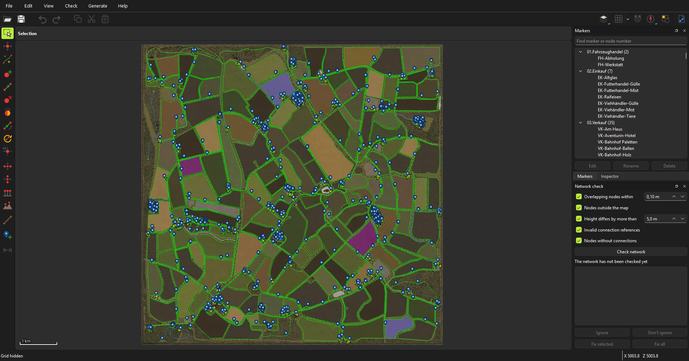
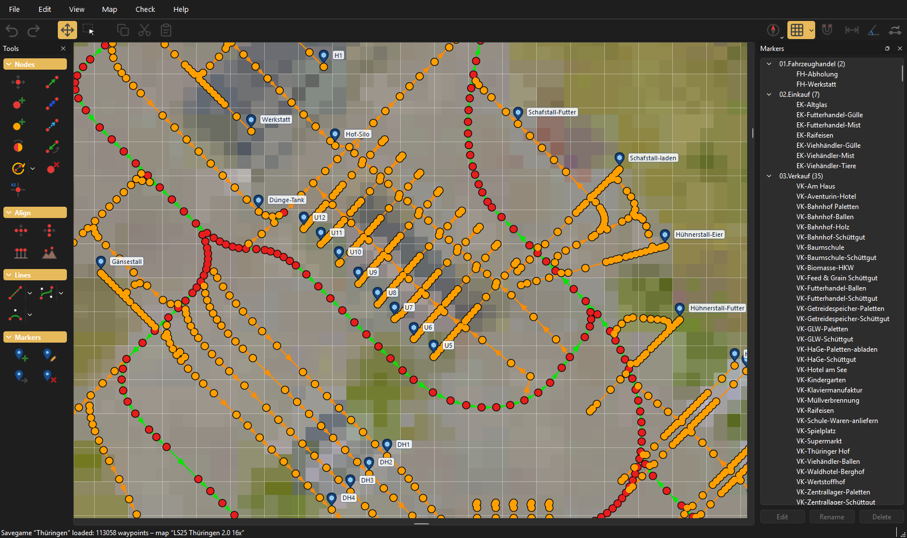
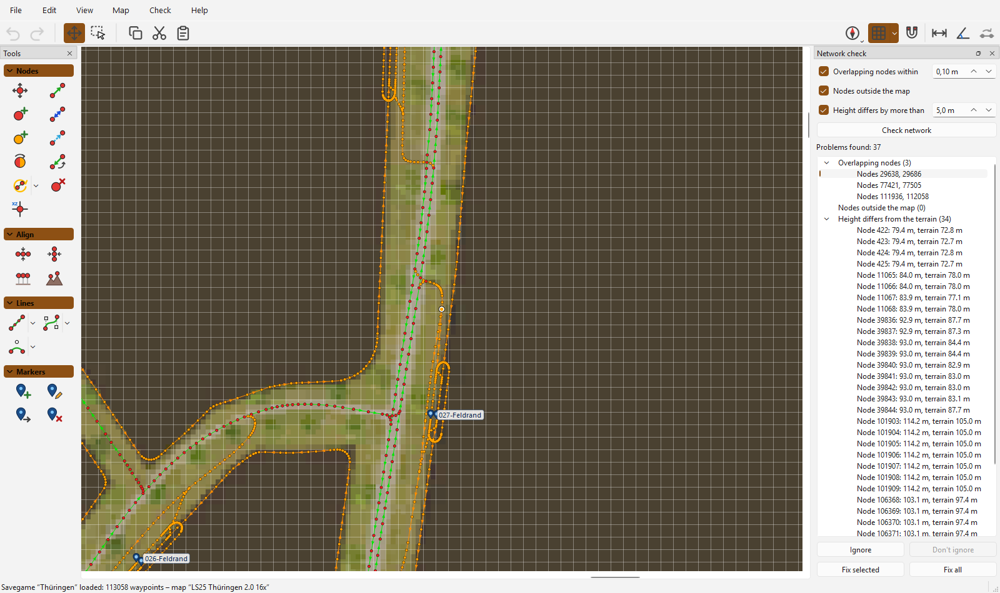

# AutoDrive FS25 Editor

[English](README.md) | **Deutsch**

[AutoDrive](https://github.com/Stephan-S/FS25_AutoDrive)-Routennetze für den Landwirtschafts-Simulator 25 direkt auf der Karte bearbeiten, mit Geländehöhen und vollständigem Rückgängig.

> **Hinweis:** Dieses Projekt ist komplett „vibe coded“. Code, Tests und Dokumentation wurden vollständig von einem KI-Programmierassistenten geschrieben, angeleitet und getestet von einem Menschen.

## Das Wichtigste

- **Deine Karten, automatisch gefunden.** Ein Savegame öffnen, und seine Karte kommt mit: Kartenbild, Heightmap und Größe werden beim ersten Mal aus dem `mods`-Ordner oder dem Grundspiel importiert, ohne Extraschritt.
- **Savegames, Routen und XML-Dateien.** Ein Savegame oder eine Route aus dem RoutesManager auf einem Öffnen-Bildschirm wählen. Mit dem Begleit-Mod `FS25_AutoDriveEditorLink` lädt Speichern das Netz im laufenden Spiel neu, ohne Neustart.
- **Zeichenwerkzeuge.** Linien, Bézierkurven und Kreisbögen mit gleichmäßigem Node-Abstand. Drehen, ausrichten, Höhen aus dem Gelände setzen und ganze Abschnitte kopieren und einfügen.
- **Netzprüfung.** Findet übereinanderliegende Nodes, Nodes außerhalb der Karte, falsche Höhen, ungültige Connection-Verweise und Nodes ohne Connections. Ein Klick springt zur Stelle; beheben mit einem Klick oder ignorieren.
- **Für große Netze gebaut.** Kommt mit Netzen über 100.000 Wegpunkten zurecht, wie dem in den Screenshots.
- **Sicher.** Rückgängig für jede Änderung, eine Sicherungskopie vor dem ersten Speichern und automatische Sicherung mit Wiederherstellung nach einem Absturz.
- **Nach deinem Geschmack.** Deutsch oder Englisch, helles oder dunkles Design, eigene Tastenkürzel.

| Hineingezoomt, dunkles Design | Netzprüfung |
| --- | --- |
|  |  |

Die Screenshots zeigen die englische Oberfläche.

## Loslegen

1. Das Zip unter [Releases](https://github.com/SvenBrauns/AutoDrive_Editor/releases/latest) herunterladen, entpacken und `AutoDrive Editor.exe` starten. Python oder Java sind nicht nötig. Das Programm ist nicht signiert, daher zeigt Windows eventuell „Der Computer wurde durch Windows geschützt“: auf `Weitere Informationen → Trotzdem ausführen` klicken.
2. Beim ersten Start die gefundenen Spielordner prüfen.
3. Auf dem Öffnen-Bildschirm ein Savegame oder eine Route wählen. Die Karte wird beim ersten Mal importiert.

Die [Anleitung](MANUAL.de.md) erklärt alle Werkzeuge, Tastenkürzel, die Netzprüfung und das Speichern.

## Im Vergleich zum AutoDrive Course Editor

Dieser Editor ist ein neuer Editor nur für den LS25. Sein erstes Ziel war alles, was der [AutoDrive Course Editor](https://github.com/KillBait/AutoDrive_Course_Editor) 1.1.1 kann.

| | Course Editor 1.1.1 | AutoDrive FS25 Editor |
| --- | :---: | :---: |
| Spiele | LS19, LS22, LS25 | LS25 |
| Läuft als | Java-Programm (Java 11+) | Windows-Programm, keine Installation |
| Sprache der Oberfläche | Englisch | Deutsch, Englisch |
| Kartenbilder | Import aus .zip oder Download | Beim Öffnen aus Mods und Spiel importiert |
| Routen, Savegames und XML-Dateien | ✅ | ✅ |
| Nodes, Connections, Marker, Kopieren und Einfügen, Rückgängig | ✅ | ✅ |
| Linien, Bézierkurven (1 oder 2 Kontrollpunkte), Kreisbögen | ✅ | ✅ |
| Drehen, Ausrichten, Positionen eingeben, Raster mit Einrasten | ✅ | ✅ |
| Connection-Arten, Marker, Parkpositionen ein- und ausblenden | ✅ | ✅ |
| Übereinanderliegende Nodes und Nodes außerhalb der Karte finden und beheben | ✅ | ✅ |
| Höhenprüfung gegen die Heightmap | Nur Nodes unterhalb der Weltgrenze | ✅ |
| Prüfergebnisse als Liste: zu jedem Problem springen, Einträge ignorieren | | ✅ |
| Freie Auswahl | | ✅ |
| Abstands- und Winkelmessung | | ✅ |
| Parkplätze in Hallen, mit Vorlagen | | ✅ |
| Kartenansicht drehen | | ✅ |
| Automatische Sicherung, Tastenkürzel, dunkles Design | ✅ | ✅ |
| Experimentelle Werkzeuge (Straßenanbindung, Skalieren, Vorlagen) | ✅ | |

## Danke

- **Stephan** und dem AutoDrive-Team (Iwan1803, Axel, Tommo, Willi) für [AutoDrive](https://github.com/Stephan-S/FS25_AutoDrive). Ohne den Mod hätte dieser Editor nichts zu bearbeiten.
- **Stephan** für den ursprünglichen Course Editor und **KillBait** für dessen Pflege und Weiterentwicklung als [AutoDrive Course Editor](https://github.com/KillBait/AutoDrive_Course_Editor). Er hat gezeigt, was ein Routeneditor braucht, und sein Funktionsumfang war das Ziel für die erste Version dieses Editors.
- **Ollimodding** für die Karte Thüringen 2.0 16x, die in den Screenshots zu sehen ist.

## Lizenz

GNU General Public License v3.0 oder neuer, siehe [LICENSE](LICENSE). Die Windows-Version enthält PySide6/Qt (LGPLv3) und Pillow, siehe [THIRD_PARTY_NOTICES.md](packaging/THIRD_PARTY_NOTICES.md).

Der Editor enthält keine Dateien aus dem Landwirtschafts-Simulator oder aus Kartenmods. Kartenbilder und Heightmaps werden aus der eigenen Installation gelesen. Nur die Screenshots in `docs/images` zeigen einen Ausschnitt eines Kartenmods. Dieses Projekt steht in keiner Verbindung zu GIANTS Software.

Hinweise zur Entwicklung (auf Englisch) stehen in [DEVELOPMENT.md](DEVELOPMENT.md), die Änderungen jeder Version im [CHANGELOG](CHANGELOG.md) (auf Englisch).
