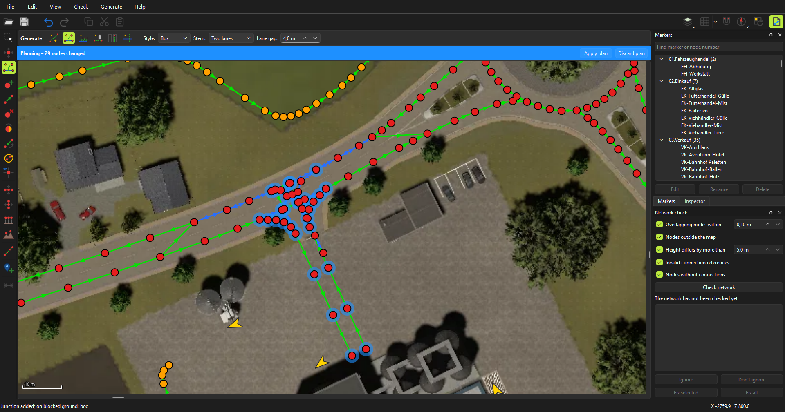
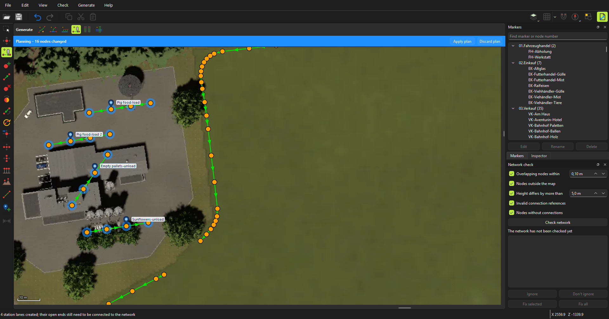
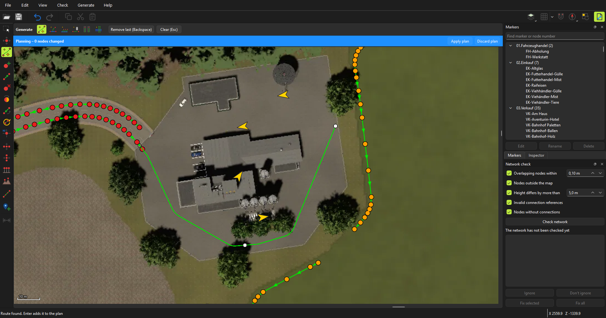
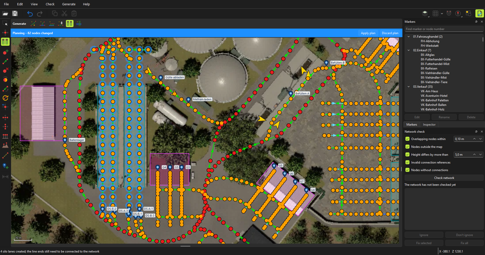

# AutoDrive FS25 Editor

[English](README.md) | **Deutsch**

[AutoDrive](https://github.com/Stephan-S/FS25_AutoDrive)-Routennetze für den Landwirtschafts-Simulator 25 direkt auf der Karte bearbeiten, mit Geländehöhen und vollständigem Rückgängig.

> **Hinweis:** Dieses Projekt ist komplett „vibe coded“. Code, Tests und Dokumentation wurden vollständig von einem KI-Programmierassistenten geschrieben, angeleitet und getestet von einem Menschen.

## Das Wichtigste

- **Generatoren für die schweren Teile.** Das Werkzeug Erzeugen baut, was von Hand am längsten dauert, als Plan, der sich noch ändern lässt:
  - **Einmündungen:** von einer Straße zu einem Hof ziehen und eine Kreuzungsbox oder Abbiegekurven bekommen, deren Spuren wie handgemachte Abzweige in die Straße münden.
  - **Stationen:** eine Einbahnspur mit Marker über jedem Halt von Verkaufsstellen, Produktionen, Silos und Ställen, und eine Hofstraße daran vorbei.
  - **Routen:** Wegpunkte anklicken und eine befahrbare Route über die Befahrbarkeitskarte des Savegames bekommen, mit eigenem Kurvenradius und eigener Fahrzeugbreite.
  - **Straßen:** AutoDrive-Straßen entlang der Verkehrsspuren der Karte, für eine angeklickte Straße, einen Rahmen oder die ganze Karte, verbunden mit den vorhandenen Straßen.
  - **Parkplätze** in Hallen und **Spuren in Fahrsilos**, mit Markern, für ein Gebäude oder viele auf einmal.
- **Planungsmodus.** Mit jedem Werkzeug bearbeiten, dann den Plan als einen Rückgängig-Schritt übernehmen oder verwerfen. Geänderte Nodes sind auf der Karte markiert.
- **Spielbild.** Der Begleit-Mod zeichnet die Karte im laufenden Spiel von oben: Höfe, Straßen und Gebäude, wie sie wirklich sind, als Hintergrund im Editor.
- **Neu laden im Spiel.** Mit dem Begleit-Mod [`FS25_AutoDriveEditorLink`](https://github.com/SvenBrauns/FS25_AutoDriveEditorLink/releases/latest) lädt Speichern das Netz im laufenden Spiel neu. Kein Neustart nötig.
- **Deine Karten, automatisch gefunden.** Ein Savegame oder eine Route aus dem RoutesManager öffnen, und die Karte kommt mit: Kartenbild, Heightmap und Größe werden beim ersten Mal aus dem `mods`-Ordner oder dem Grundspiel importiert.
- **Zeichnen und Straßen bearbeiten.** Linien, Bézierkurven und Kreisbögen mit gleichmäßigem Node-Abstand, parallele Spuren, Nodes in Connections einfügen, löschen und neu verbinden. Drehen, ausrichten, Höhen aus dem Gelände setzen, ganze Abschnitte kopieren und einfügen.
- **Suchen.** Marker nach Name oder Gruppe suchen oder per Nummer zu einem Node springen.
- **Netzprüfung.** Findet übereinanderliegende Nodes, falsche Höhen, kaputte Connections, Nodes ohne Connections und Lücken im Straßennetz. Ein Klick springt zur Stelle; beheben mit einem Klick oder ignorieren.
- **Für große Netze gebaut.** Kommt mit Netzen über 100.000 Wegpunkten zurecht, wie dem in den Screenshots.
- **Sicher.** Rückgängig für jede Änderung, eine Sicherungskopie vor dem ersten Speichern, automatische Sicherung mit Wiederherstellung nach einem Absturz und eine Warnung, wenn das Spiel die Datei inzwischen geändert hat.
- **Nach deinem Geschmack.** Deutsch oder Englisch, helles oder dunkles Design, eigene Tastenkürzel.

| Einmündung | Stationsspuren |
| --- | --- |
|  |  |
| **Route** | **Fahrsilos** |
|  |  |

Die Screenshots zeigen die englische Oberfläche.

## Loslegen

1. Das Zip unter [Releases](https://github.com/SvenBrauns/AutoDrive_Editor/releases/latest) herunterladen, entpacken und `AutoDrive Editor.exe` starten. Python oder Java sind nicht nötig. Das Programm ist nicht signiert, daher zeigt Windows eventuell „Der Computer wurde durch Windows geschützt“: auf `Weitere Informationen → Trotzdem ausführen` klicken.
2. Beim ersten Start die gefundenen Spielordner prüfen.
3. Auf dem Öffnen-Bildschirm ein Savegame oder eine Route wählen. Die Karte wird beim ersten Mal importiert.
4. Optional: Für das Spielbild und das Neuladen im Spiel das Zip des Begleit-Mods [`FS25_AutoDriveEditorLink`](https://github.com/SvenBrauns/FS25_AutoDriveEditorLink/releases/latest) in den `mods`-Ordner legen und im Savegame aktivieren.

Die [Anleitung](MANUAL.de.md) erklärt alle Werkzeuge, Tastenkürzel, die Netzprüfung und das Speichern.

## Danke

- **Stephan** und dem AutoDrive-Team (Iwan1803, Axel, Tommo, Willi) für [AutoDrive](https://github.com/Stephan-S/FS25_AutoDrive). Ohne den Mod hätte dieser Editor nichts zu bearbeiten.
- **Stephan** für den ursprünglichen Course Editor und **KillBait** für dessen Pflege und Weiterentwicklung als [AutoDrive Course Editor](https://github.com/KillBait/AutoDrive_Course_Editor). Er hat gezeigt, was ein Routeneditor braucht, und sein Funktionsumfang war das Ziel für die erste Version dieses Editors.
- **Ollimodding** für die Karte Thüringen 2.0 16x, die in den Screenshots zu sehen ist.

## Lizenz

GNU General Public License v3.0 oder neuer, siehe [LICENSE](LICENSE). Die Windows-Version enthält PySide6/Qt (LGPLv3) und Pillow. Zum Lesen der `.i3d.shapes`-Dateien der Karte dient eine Portierung von [I3DShapesTool](https://github.com/Donkie/I3DShapesTool) von Daniel Hultgren (MIT). Siehe [THIRD_PARTY_NOTICES.md](packaging/THIRD_PARTY_NOTICES.md).

Der Editor enthält keine Dateien aus dem Landwirtschafts-Simulator oder aus Kartenmods. Kartenbilder und Heightmaps werden aus der eigenen Installation gelesen. Nur die Screenshots in `docs/images` zeigen einen Ausschnitt eines Kartenmods. Dieses Projekt steht in keiner Verbindung zu GIANTS Software.

Hinweise zur Entwicklung (auf Englisch) stehen in [DEVELOPMENT.md](DEVELOPMENT.md), die Änderungen jeder Version im [CHANGELOG](CHANGELOG.md) (auf Englisch).
