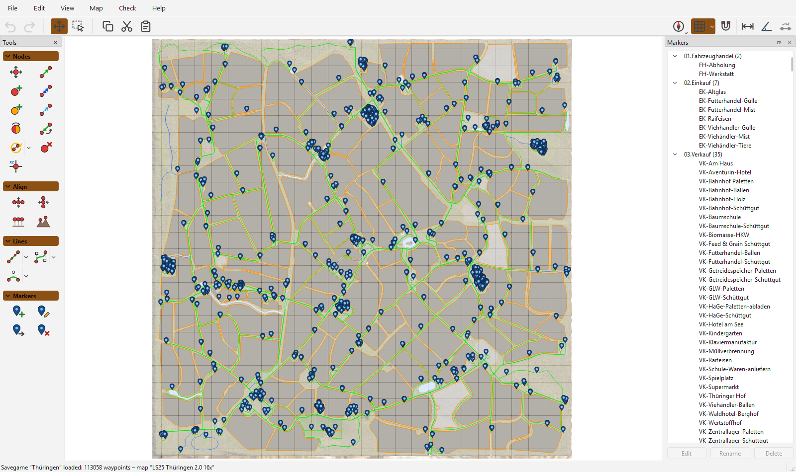
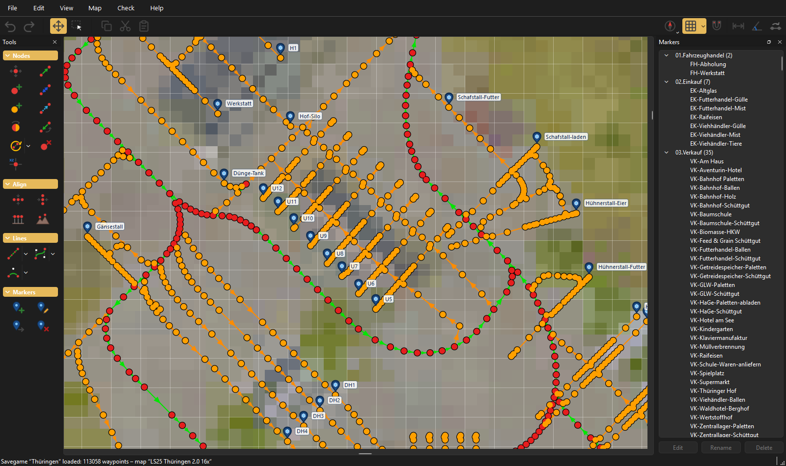
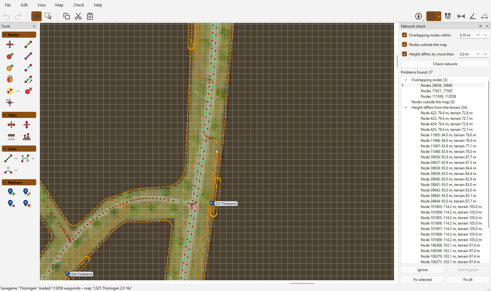

# AutoDrive FS25 Editor

**English** | [Deutsch](README.de.md)

Edit [AutoDrive](https://github.com/Stephan-S/FS25_AutoDrive) route networks for Farming Simulator 25 on the real map, with terrain heights and full undo.

> **Disclaimer:** This project is fully vibe coded. All code, tests and documentation were written by an AI coding assistant, guided and tested by a human.

## Highlights

- **Your maps, found automatically.** One scan imports map image, heightmap and size from your `mods` folder and the base game. The right map opens with every route.
- **Routes, savegames and XML files.** Open routes from AutoDrive's RoutesManager and reload them in the running game, no restart needed.
- **Drawing tools.** Lines, Bézier curves and arcs with even node spacing. Rotate, align, set heights from the terrain, and copy and paste whole sections.
- **Network check.** Finds overlapping nodes, nodes outside the map and wrong heights. Click an entry to jump to it, fix it with one click, or ignore it.
- **Built for large networks.** Handles networks with more than 100,000 waypoints, like the one in the screenshots.
- **Safe to use.** Undo for every change, a backup before the first save, and autosave with restore after a crash.
- **Your way.** English or German, light or dark theme, your own keyboard shortcuts.

| Zoomed in, dark theme | Network check |
| --- | --- |
|  |  |

## Getting started

1. Download the zip from [Releases](https://github.com/SvenBrauns/AutoDrive_Editor/releases/latest), unzip it and start `AutoDrive Editor.exe`. No Python or Java is needed. The program is not signed, so Windows may show "Windows protected your PC": click `More info → Run anyway`.
2. On first start, check the game folders the editor found.
3. Run `Map → Scan maps` once to import your maps.
4. Open a route, savegame or XML file from the `File` menu.

The [manual](MANUAL.md) explains all tools, shortcuts, the network check and saving.

## Compared to the AutoDrive Course Editor

This editor is a new FS25-only editor. Its first goal was everything the [AutoDrive Course Editor](https://github.com/KillBait/AutoDrive_Course_Editor) 1.1.1 can do.

| | Course Editor 1.1.1 | AutoDrive FS25 Editor |
| --- | :---: | :---: |
| Games | FS19, FS22, FS25 | FS25 |
| Runs as | Java program (Java 11+) | Windows program, nothing to install |
| Interface language | English | English, German |
| Map images | Import from .zip or download | Scanned from your mods and the game |
| Routes, savegames and XML files | ✅ | ✅ |
| Nodes, connections, markers, copy and paste, undo | ✅ | ✅ |
| Lines, Bézier curves (1 or 2 control points), arcs | ✅ | ✅ |
| Rotate, align, enter positions, grid snapping | ✅ | ✅ |
| Show and hide connection types, markers, parking positions | ✅ | ✅ |
| Find and fix overlapping nodes, nodes outside the map | ✅ | ✅ |
| Height check against the heightmap | Only nodes below world bounds | ✅ |
| Check results as a list: jump to each problem, ignore entries | | ✅ |
| Freehand selection | | ✅ |
| Distance and angle measurement | | ✅ |
| Parking spots in sheds, with templates | | ✅ |
| Rotate the map view | | ✅ |
| Autosave, keyboard shortcuts, dark theme | ✅ | ✅ |
| Experimental tools (road connection, scale, templates) | ✅ | |

## Thanks

- **Stephan** and the AutoDrive team (Iwan1803, Axel, Tommo, Willi) for [AutoDrive](https://github.com/Stephan-S/FS25_AutoDrive). Without the mod, this editor would have nothing to edit.
- **Stephan** for creating the original course editor, and **KillBait** for maintaining and extending it as the [AutoDrive Course Editor](https://github.com/KillBait/AutoDrive_Course_Editor). It showed what a route editor needs, and its feature set was the target for this editor's first release.
- **Ollimodding** for the map Thüringen 2.0 16x, shown in the screenshots.

## License

GNU General Public License v3.0 or later, see [LICENSE](LICENSE). The Windows version contains PySide6/Qt (LGPLv3) and Pillow, see [THIRD_PARTY_NOTICES.md](packaging/THIRD_PARTY_NOTICES.md).

The editor contains no files from Farming Simulator or from map mods. Map images and heightmaps are read from your own installation. Only the screenshots in `docs/images` show part of a map mod. This project has no connection to GIANTS Software.

For development, see [DEVELOPMENT.md](DEVELOPMENT.md). Changes in each version are listed in the [CHANGELOG](CHANGELOG.md).
