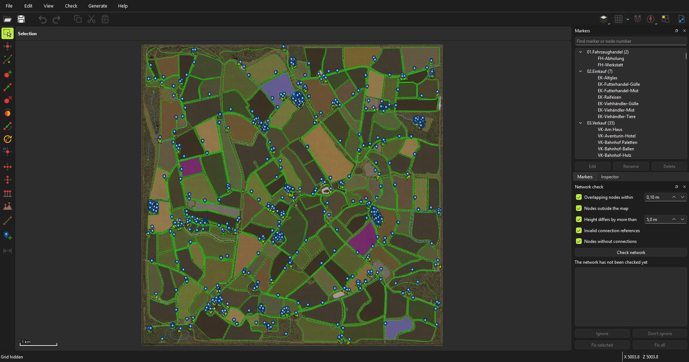
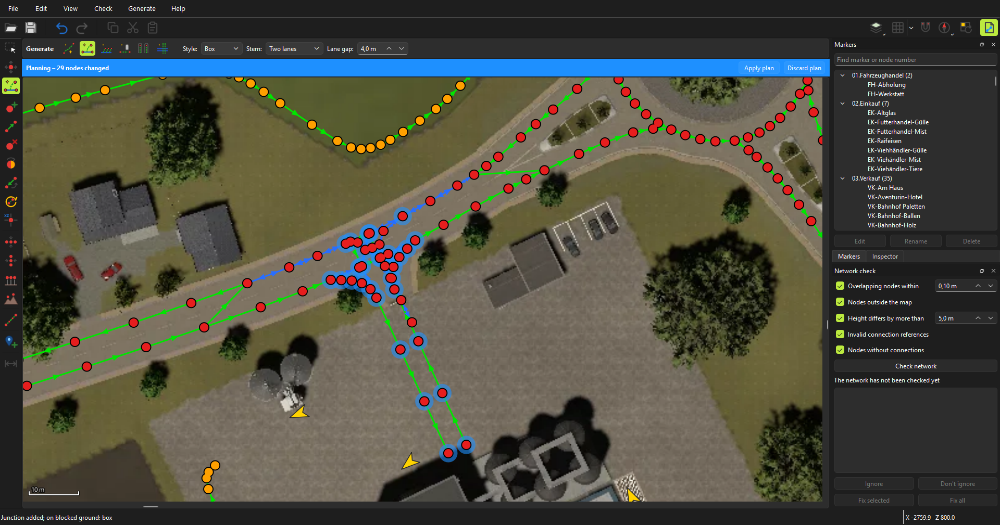
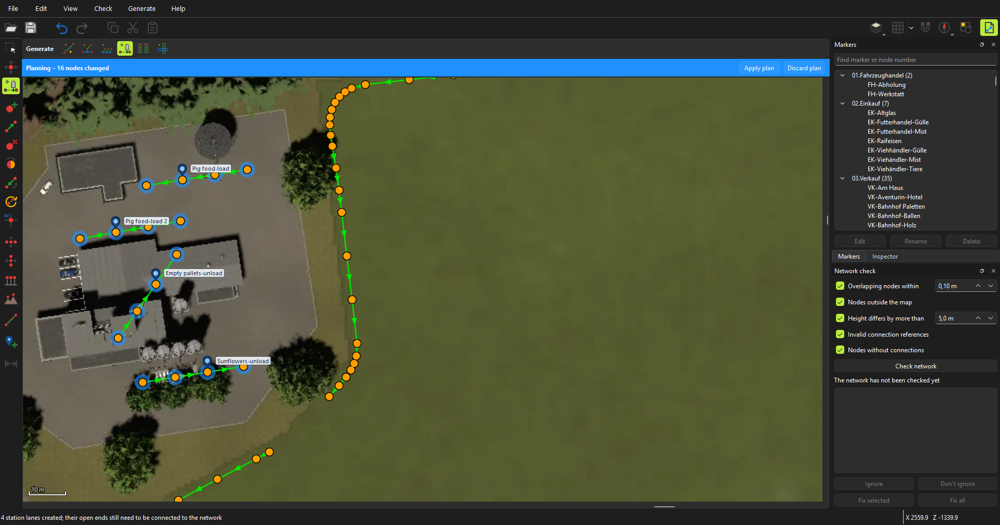
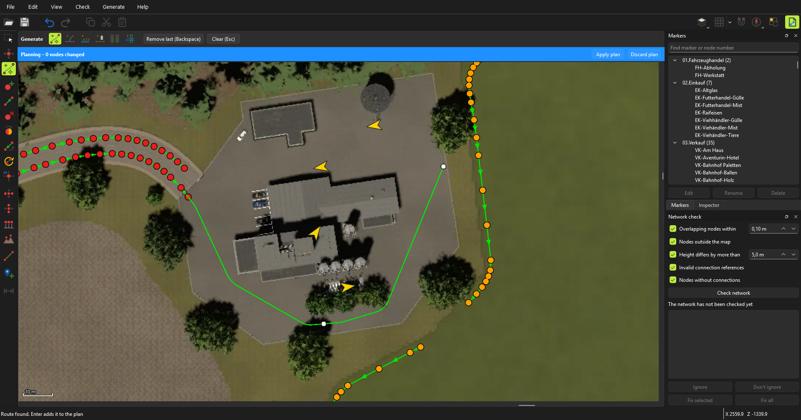
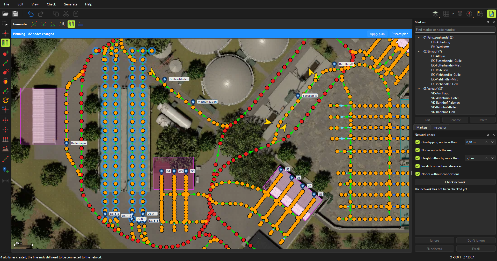

# AutoDrive FS25 Editor

**English** | [Deutsch](README.de.md)

Edit [AutoDrive](https://github.com/Stephan-S/FS25_AutoDrive) route networks for Farming Simulator 25 on the real map, with terrain heights and full undo.

> **Disclaimer:** This project is fully vibe coded. All code, tests and documentation were written by an AI coding assistant, guided and tested by a human.

## Highlights

- **Generators for the hard parts.** The Generate tool builds what takes longest by hand, as a plan you can still change:
  - **Junctions:** drag from a road towards a yard and get a crossing box or turn curves, with lanes that join the road like hand-made forks.
  - **Stations:** a one-way lane with a marker over each stop of selling points, productions, silos and barns, and a yard road past them.
  - **Routes:** click waypoints and get a drivable route over the savegame's drivability map, with your curve radius and vehicle width.
  - **Roads:** AutoDrive roads along the map's own traffic lanes, for a clicked road, a box or the whole map, joined to the roads you have.
  - **Parking spots** in sheds and **lanes in bunker silos**, with markers, for one building or many at once.
- **Planning mode.** Edit with every tool, then apply the plan as one undo step or throw it away. Changed nodes are marked on the map.
- **Game picture.** The companion mod renders the map from above in the running game: your yards, roads and buildings as they really are, as the editor's background.
- **Reload in the game.** With the companion mod [`FS25_AutoDriveEditorLink`](https://github.com/SvenBrauns/FS25_AutoDriveEditorLink/releases/latest), Save reloads the network in the running game. No restart needed.
- **Your maps, found automatically.** Open a savegame or a RoutesManager route and its map comes with it: map image, heightmap and size are imported from your `mods` folder or the base game the first time.
- **Drawing and road editing.** Lines, Bézier curves and arcs with even node spacing, parallel lanes, inserting nodes into connections, deleting with reconnect. Rotate, align, set heights from the terrain, copy and paste whole sections.
- **Find.** Search markers by name or group, or jump to a node by its number.
- **Network check.** Finds overlapping nodes, wrong heights, broken connections, unconnected nodes and gaps in the road network. Click an entry to jump to it, fix it with one click, or ignore it.
- **Built for large networks.** Handles networks with more than 100,000 waypoints, like the one in the screenshots.
- **Safe to use.** Undo for every change, a backup before the first save, autosave with restore after a crash, and a warning when the game changed the file in the meantime.
- **Your way.** English or German, light or dark theme, your own keyboard shortcuts.

| Junction | Station lanes |
| --- | --- |
|  |  |
| **Route** | **Bunker silos** |
|  |  |

## Getting started

1. Download the zip from [Releases](https://github.com/SvenBrauns/AutoDrive_Editor/releases/latest), unzip it and start `AutoDrive Editor.exe`. No Python or Java is needed. The program is not signed, so Windows may show "Windows protected your PC": click `More info → Run anyway`.
2. On first start, check the game folders the editor found.
3. Pick a savegame or route on the Open screen. Its map is imported the first time.
4. Optional: for the game picture and reloading in the game, put the zip of the companion mod [`FS25_AutoDriveEditorLink`](https://github.com/SvenBrauns/FS25_AutoDriveEditorLink/releases/latest) into your `mods` folder and activate it in the savegame.

The [manual](MANUAL.md) explains all tools, shortcuts, the network check and saving.

## Thanks

- **Stephan** and the AutoDrive team (Iwan1803, Axel, Tommo, Willi) for [AutoDrive](https://github.com/Stephan-S/FS25_AutoDrive). Without the mod, this editor would have nothing to edit.
- **Stephan** for creating the original course editor, and **KillBait** for maintaining and extending it as the [AutoDrive Course Editor](https://github.com/KillBait/AutoDrive_Course_Editor). It showed what a route editor needs, and its feature set was the target for this editor's first release.
- **Ollimodding** for the map Thüringen 2.0 16x, shown in the screenshots.

## License

GNU General Public License v3.0 or later, see [LICENSE](LICENSE). The Windows version contains PySide6/Qt (LGPLv3) and Pillow. Reading the map's `.i3d.shapes` files uses a port of [I3DShapesTool](https://github.com/Donkie/I3DShapesTool) by Daniel Hultgren (MIT). See [THIRD_PARTY_NOTICES.md](packaging/THIRD_PARTY_NOTICES.md).

The editor contains no files from Farming Simulator or from map mods. Map images and heightmaps are read from your own installation. Only the screenshots in `docs/images` show part of a map mod. This project has no connection to GIANTS Software.

For development, see [DEVELOPMENT.md](DEVELOPMENT.md). Changes in each version are listed in the [CHANGELOG](CHANGELOG.md).
